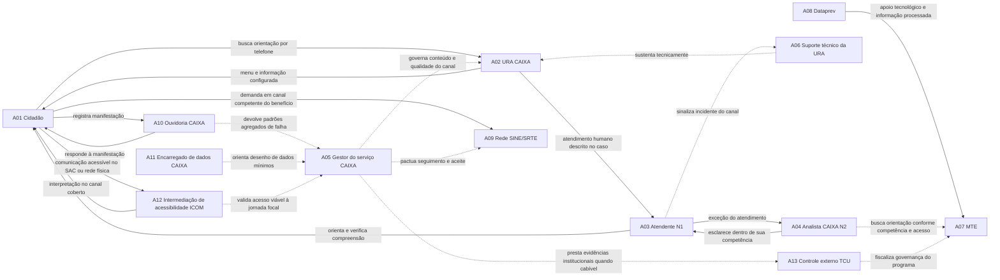

# Mapa de atores — orientação sobre Seguro-Desemprego pela URA CAIXA

**Aluno:** Maycon Douglas — TD-2026-03.
**Serviço e canal:** Atendimento ao Seguro-Desemprego pela URA da Caixa
Econômica Federal, CAIXA Cidadão 0800 726 0207.
**Data:** 13/11/2026. **Produção:** agente Codex, com decisões delegadas.

## 1. Propósito, fronteira e evidência

O mapa torna visíveis as responsabilidades pela orientação e pelo próximo
passo do cidadão. A jornada começa na tentativa de obter informação por
telefone e pode terminar com orientação compreendida, encaminhamento com
estado conhecido ou interrupção identificada. Concessão, pagamento e recurso
são domínios externos ao atendimento do menu. Essas fronteiras foram
fixadas na **rodada 1, decisão D01**, da
[autoentrevista](C_grill_transcript.md).

O inventário conserva exatamente os treze atores da **rodada 2, D02**.
Papéis N1/N2 e a URA têm referência no estudo de caso de 2025; isso não
certifica o organograma vigente. Gestão e suporte são funções analíticas
a confirmar. A matriz de responsabilidades e os mecanismos de seguimento
são propostas de desenho, não acordos operacionais homologados.

Legenda: **E** = relação ou função descrita em fonte citada, dentro do
escopo dessa fonte; **P** = responsabilidade proposta ou conexão a validar.
Mesmo E não significa observação direta realizada neste trabalho. As
classificações qualitativas de poder/interesse são hipóteses de análise.

## 2. Inventário, papéis e momentos da jornada

| ID e ator | Categoria e papel | Entra na jornada quando | Sai ou encerra sua participação quando | Limite, evidência e decisão |
| --- | --- | --- | --- | --- |
| **A01 — Cidadão** | Usuário direto; apresenta dúvida e avalia se consegue agir | Tenta obter orientação sobre o benefício | Compreende o próximo passo, confirma recebimento ou interrompe o contato | Interrupção não é resolução; inclui diversidade de acesso. E: F1/F3. D01, D06, D07. |
| **A02 — URA CAIXA** | Sistema automatizado; entrada, menu e informação configurada | Recebe a chamada | Entrega informação, ocorre saída para atendimento humano ou interrupção | Não é autoridade de concessão nem IA generativa comprovada. E: F1. D03. |
| **A03 — Atendente N1** | Operador humano; triagem e orientação inicial | A demanda exige atendimento humano conforme o canal | Entrega orientação ou registra escalonamento pendente | Competência e acessos limitados; unidade vigente a confirmar. E: F1. D04–D06. |
| **A04 — Analista CAIXA N2** | Especialista humano; exceções do atendimento | Triagem identifica questão que demanda análise especializada | Esclarece questão de sua competência ou define destino adequado | Não decide por outro órgão. E: F1; encaminhamento P. D04–D06. |
| **A05 — Gestor do serviço CAIXA** | Gestão; conteúdo, qualidade e seguimento do canal | Planeja o atendimento ou recebe pendência/incidente | Fecha ação de melhoria ou mantém acompanhamento explícito da pendência | Função e responsabilidade propostas, sem unidade inventada. P. D05, D06, D09. |
| **A06 — Suporte técnico da URA** | Sustentação tecnológica; diagnóstico e correção técnica | Há incidente ou mudança técnica autorizada | Funcionamento é restabelecido e a verificação retorna à gestão/operação | Prestador não identificado; não concede benefício. P. D03, D05. |
| **A07 — MTE** | Órgão gestor e autoridade administrativa do benefício | A demanda pertence à concessão, recurso ou outra decisão de seu domínio | Emite decisão ou orientação de sua competência | Não se presume integração de sistema ou transferência de chamada. E: F3/F4/F6. D04. |
| **A08 — Dataprev** | Organização de tecnologia e processamento de informações | Há necessidade de informação/processamento autorizado no domínio competente | Entrega informação ou sinaliza limitação técnica | Tecnologia não equivale à competência administrativa do MTE. E: F5/F6. D04, D11. |
| **A09 — Rede SINE/SRTE** | Atendimento complementar; apoio no domínio do benefício | Há necessidade de atendimento em posto/canal competente | Registra atendimento ou próximo passo dentro de sua atribuição | Disponibilidade e aceite devem ser confirmados; sem transferência automática. E: F1/F3/F4; continuidade P. D04, D06. |
| **A10 — Ouvidoria CAIXA** | Escuta crítica e tratamento de manifestações | Cidadão registra manifestação no canal apropriado | Responde à manifestação e encaminha padrões de melhoria, quando cabível | Não é instância de concessão. E: F9; aprendizagem P. D09. |
| **A11 — Encarregado de dados CAIXA** | Governança de dados; comunicação e orientação | Surgem questões de proteção de dados ou desenho de registros | Orienta o tratamento da questão em seu papel institucional | Não aprova benefício nem autoriza universalmente acessos. E: F8; consulta ao desenho P. D08. |
| **A12 — Intermediação de acessibilidade ICOM** | Mediação humana acessível em canais cobertos | Usuário busca interpretação no SAC ou rede física documentada | Conclui interpretação no canal coberto ou identifica barreira | Conexão com a jornada focal é P; não há prova de integração direta à URA. E: F7. D07. |
| **A13 — Controle externo TCU** | Fiscalização institucional da governança do programa | Há ação de fiscalização segundo sua competência | Emite resultados e acompanha encaminhamentos institucionais | Atuação eventual, fora da triagem de cada chamada. E: F6. D10. |

## 3. Rede de relações rotuladas

Setas contínuas representam relações descritas nas fontes, sem afirmar
integração técnica. Setas tracejadas são recomendações, consultas ou
dependências de governança a validar. O diagrama não representa todas as
ligações como uma única chamada nem acesso irrestrito a dados.

As relações Atendente N1 → Analista CAIXA N2 e Dataprev → MTE explicitam
dependências diferentes: a primeira é de tratamento do atendimento no
estudo; a segunda é de tecnologia/informação. A passagem ao MTE não é uma
permissão de alteração de benefício por N1/N2. A relação com ICOM trata de
comunicação acessível nos canais cobertos, com ligação à jornada focal
ainda a validar. Isso preserva **D04 e D07**, das rodadas 4 e 7.

## 4. RACI por atividade

**R** executa; **A** responde pelo resultado da atividade; **C** é consultado;
**I** recebe a informação pertinente. Cada linha tem um único A e ao menos
um R, conforme a **rodada 12, D12**. A matriz é proposta analítica. A
responsabilidade de uma instituição em seu domínio não cria subordinação
entre CAIXA, MTE, ICOM, Ouvidoria e TCU. As consultas e comunicações dependem
de competência e acesso autorizado, usando apenas informação necessária.

| Atividade | R | A | C | I |
| --- | --- | --- | --- | --- |
| Oferecer menu e conteúdo configurado | A02 | A05 | A03, A06 | A01 |
| Fazer triagem e orientação inicial | A03 | A05 | A04 | A01 |
| Tratar exceção do atendimento CAIXA | A04 | A05 | A07, A08, conforme acesso | A01, A03 |
| Encaminhar e acompanhar a pendência do canal | A03, A04 | A05 | A07, A09 | A01 |
| Decidir concessão ou recurso, fora do canal focal | A07 | A07 | A08, A09, conforme competência | A01 |
| Atender a demanda complementar em posto competente | A09 | A07 | A08, conforme atribuição | A01 |
| Tratar incidente técnico do canal | A06 | A05 | A03, A04 | A03 |
| Intermediar comunicação no canal acessível coberto | A12 | A12 | A01 | A05, apenas em avaliação agregada |
| Validar desenho e necessidade de registros do canal | A05 | A05 | A11 | A03, A04 |
| Tratar manifestação e sua devolutiva | A10 | A10 | A05 | A01 |
| Fiscalizar governança no âmbito de sua competência | A13 | A13 | A07, A05 | A01, por resultados públicos quando cabível |

A08 participa como infraestrutura de informação, e não como aprovador de
concessão. A11 aparece como consulta sobre dados, sem ser transformado em
aprovador universal. A13 responde pela sua atividade de fiscalização,
sem aprovar cada atendimento. Essas escolhas foram decididas nas
**rodadas 4, 8 e 10 (D04, D08, D10)**.

## 5. Estados, entrada e saída sem encerrar o problema artificialmente

| Estado | Condição de entrada | Condição de saída e responsável proposto |
| --- | --- | --- |
| Em atendimento | Demanda apresentada na URA ou no atendimento humano | Orientação classificada; N1/N2 conduzem e A05 acompanha a organização do canal |
| Orientado | Informação de competência do canal foi fornecida | Próximo passo compreendido, com verificação no atendimento humano; não significa benefício concedido |
| Encaminhamento pendente | A demanda requer outro papel ou instituição | Aceite confirmado pelo destino ou confirmação de recebimento pelo cidadão; A05 acompanha a continuidade do canal |
| Recebimento confirmado | Há evidência de orientação recebida ou caso aceito | O destino segue seu processo; decisão administrativa pode continuar pendente |
| Abandono ou contato interrompido | Contato termina sem verificar orientação | Classificar como interrupção e investigar barreiras; não contabilizar automaticamente como resolução |

Conforme a **rodada 6, D06**, informar um número de telefone não é evidência
suficiente para declarar a dúvida resolvida. O seguimento depende de
pactuação com o destino; a proposta não comprova protocolo compartilhado,
prazo, API ou transferência de chamada existente.

Conforme a **rodada 8, D08**, o registro proposto é de atendimento:
identificador do contato, classe da dúvida, estado, destino e responsável
funcional. Não há CPF, gravação ou caso pessoal neste trabalho público.
Tratamento necessário, acesso e retenção precisam de validação antes de
qualquer implantação; a entrega é um mapa, não um novo cadastro.

## 6. Poder, interesse, tensões e ação de engajamento

As hipóteses abaixo aplicam a metodologia da aula 2 e a **rodada 11, D11**.
“Poder” significa influência no domínio descrito; não é poder sobre todas
as etapas do serviço. Interesse não foi medido em pesquisa de campo.

| Atores | Poder/interesse como hipótese | Tensão ou ganho a investigar | Engajamento proposto |
| --- | --- | --- | --- |
| A01 | Baixo poder institucional; alto impacto sofrido | Ganho de autonomia; risco de exclusão por linguagem ou canal | Ouvir usuários diversos e testar compreensão e próximo passo |
| A02 | Sem interesse humano próprio; capacidades configuradas | Conteúdo curto pode deixar uma exceção sem orientação | Validar conteúdo com gestão e operação, sem antropomorfizar o sistema |
| A03, A04 | Poder limitado sobre política; alto impacto na orientação | Produtividade versus tempo para explicar e acompanhar | Investigar trabalho real e testar casos de exceção com operadores |
| A05 | Alto poder sobre o canal; interesse a confirmar | Reduzir repetição sem ocultar pendências | Pactuar responsabilidade, critérios de aceite e devolutivas |
| A06, A08 | Alta influência técnica, domínio administrativo delimitado | Disponibilidade versus informação contextual e acessos | Validar dependências e limites com a gestão competente |
| A07 | Alto poder no domínio do benefício; interesse a confirmar | Preservar competência e evitar encaminhamento circular | Validar fronteiras e casos de exceção em conjunto com CAIXA |
| A09 | Poder no atendimento complementar, conforme atribuição | Receber casos com contexto suficiente e evitar devoluções | Verificar acesso local, motivo e aceite do encaminhamento |
| A10 | Influência pela escuta e manifestação | Resposta formal versus melhoria efetiva | Dar retorno sobre padrões recorrentes e mudanças propostas |
| A11 | Influência de orientação em dados, sem decidir benefício | Rastreabilidade versus tratamento excessivo de dados | Consultar necessidade, acesso, retenção e comunicação ao titular |
| A12 | Influência na mediação; dependência de cobertura do canal | Autonomia do usuário versus barreira de dispositivo/internet | Testar viabilidade e registrar alternativa ainda a validar |
| A13 | Alto poder de fiscalização; atuação eventual | Evidência auditável versus controles sem utilidade para o cidadão | Preparar governança e dados agregados, sem aprovação por ligação |

## 7. Decisões rastreadas e pendências

| Escolha do mapa | Origem no transcript | Efeito no artefato |
| --- | --- | --- |
| Recorte informacional, sem decidir concessão no menu | Rodada 1, D01; rodada 4, D04 | Fronteira, inventário e RACI separam canal e domínio do benefício |
| Treze atores com IDs consistentes | Rodada 2, D02 | Mesmas identidades na tabela, diagrama e responsabilidades |
| Fechamento por orientação ou recebimento verificável | Rodada 6, D06 | Tabela de estados mantém pendências e abandono visíveis |
| ICOM como ator de fronteira com conexão a validar | Rodada 7, D07 | Inventário e seta tracejada não prometem integração direta à URA |
| Registros mínimos e consulta ao encarregado | Rodada 8, D08 | RACI e governança limitam o tratamento proposto |
| Escuta crítica e controle fora do fluxo por ligação | Rodadas 9 e 10, D09/D10 | Relações de aprendizagem e fiscalização sem poder de concessão |
| Um A por atividade e legenda E/P | Rodada 12, D12 | Responsabilização explícita e distinção entre evidência e proposta |

Persistem as pendências fechadas na **rodada 13, D13**: confirmar unidade e
prestador internos com a gestão; verificar mecanismo de aceite com MTE e
Rede SINE/SRTE; recuperar a regra/base da métrica histórica; testar acesso
e compreensão com usuários e canais competentes. O gestor é o articulador
proposto, sem poder de resolver sozinho competências de outra instituição.

## 8. Fontes

- **F1:** [Estudo de caso da URA CAIXA](https://github.com/alexlopespereira/idp_governodigital/blob/main/trabalho_final/seguro-desemprego-ura-caixa.pdf), páginas PDF 3–7 e 12–14; dados e diagnóstico de 2025.
- **F2:** [Aula 2](https://github.com/alexlopespereira/idp_governodigital/blob/main/pdfs/aula02.pdf), páginas PDF 31–40; propósito, diversidade, incentivos e relações.
- **F3:** [Serviço Seguro-Desemprego — MTE](https://www.gov.br/pt-br/servicos/solicitar-o-seguro-desemprego), responsável, etapas e canais; consulta em 13/11/2026.
- **F4:** [FAQ — CAIXA](https://www.caixa.gov.br/beneficios-trabalhador/seguro-desemprego/perguntas-frequentes/Paginas/default.aspx), consulta e competência sobre concessão; conteúdo indexado, abertura com redirecionamentos.
- **F5:** [Soluções para o cidadão — Dataprev](https://portal.dataprev.gov.br/solucoes/para_o_cidadao), papel tecnológico; consulta em 13/11/2026.
- **F6:** [TCU — TC 006.464/2022-0](https://portal.tcu.gov.br/data/files/57/D4/72/8E/1E56D810943E72C8E18818A8/006.464-2022-0-MBC%20-%20auditoria_seguro-desemprego.pdf), itens 9.1.2 e 9.1.3; documento de outro período.
- **F7:** [CAIXA — Libras](https://www.caixa.gov.br/atendimento/libras/Paginas/default.aspx), cobertura de interpretação; conteúdo público indexado em 13/11/2026.
- **F8:** [CAIXA — privacidade](https://www.caixa.gov.br/privacidade/Paginas/default.aspx), função de encarregado; conteúdo público indexado em 13/11/2026.
- **F9:** [CAIXA — atendimento e Ouvidoria](https://www.caixa.gov.br/atendimento/telefones-app/Paginas/default.aspx), manifestações; conteúdo público indexado em 13/11/2026.
