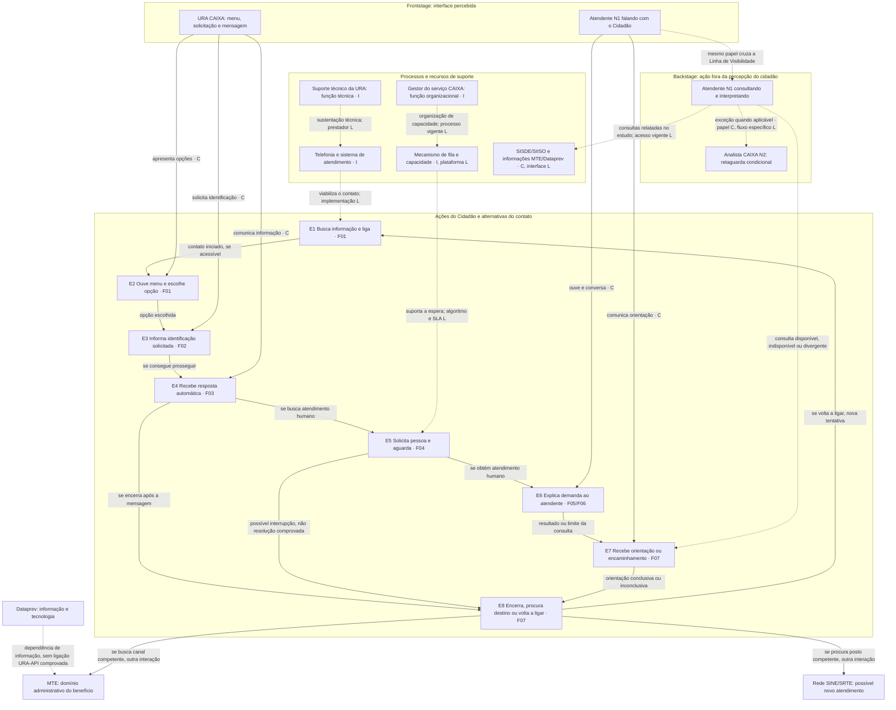

# Diagrama AS-IS — jornada do Seguro-Desemprego pela URA CAIXA

**Aluno:** Maycon Douglas — TD-2026-03. **Data:** 14/11/2026.
**Serviço:** Atendimento ao Seguro-Desemprego pela URA da Caixa Econômica
Federal, CAIXA Cidadão 0800 726 0207.

Este diagrama deriva do [blueprint da Parte C](C_blueprint_asis.md) e das
**rodadas 2,5,7,8 e 11 (G02,G05,G07,G08,G11)** do
[transcript](C_grill_transcript.md). É AS-IS documental do caso de 2025,
não teste do canal atual nem redesenho TO-BE.

## Legenda

E1–E8 mantêm os nomes da Parte C. Setas entre etapas mostram sequência e
alternativas; sua presença não significa integração técnica. Relações
tracejadas com atores/recursos mostram suporte e dependências, com **C**
(descrição do caso), **F** (competência publicada), **I** (inferência
funcional) ou **L** (detalhe não levantado). Nenhuma seta representa uma
API comprovada. O fluxo distingue fim de contato de resolução da dúvida.

## Jornada e relações operacionais

## Correspondência com a Parte C

| Elemento de D | Origem em C | Relação que torna explícita |
| --- | --- | --- |
| E1–E4 e URA | Matriz: entrada, menu, identificação e resposta | A interface automatizada não é o processamento interno nem prova autenticação forte |
| E4 → E8 / E4 → E5 | Saídas condicionais; G07 | Encerrar após mensagem e buscar atendimento humano são alternativas |
| E5 → E6 / E5 → E8 | Espera e possível interrupção | Esperar não garante acesso humano ou resolução da dúvida |
| N1F / N1B / N2 | Frontstage e backstage em E6; G05 | Mesmo N1 cruza a visibilidade; N2 é retaguarda condicional |
| Telefonia, fila e dados | Processos de suporte; G06 | Recursos sustentam ações, com plataforma, interface e acessos desconhecidos |
| E6 → E7 | F05/F06 separados no catálogo | O resultado pode ser informação disponível, limitação ou divergência; não sucesso automático |
| E7 → E8 → E1 | F07 e recontato; G07/G08 | Orientação inconclusiva pode gerar nova tentativa, sem frequência presumida |
| MTE/Dataprev/Rede SINE/SRTE | Competências e fronteira de C | Dependência externa não significa API ou transferência de chamada |

## Fail points conservados

**F01:** barreira de acesso/compreensão em E1/E2; **F02:** identificador
não localizado em E3; **F03:** resposta genérica em E4; **F04:** espera e
possível interrupção em E5; **F05:** informação indisponível em E6;
**F06:** informação divergente em E6; **F07:** encaminhamento inconclusivo
e possível recontato em E7/E8. O catálogo de C fornece fontes e limites.

F05 não produz informação consultada com sucesso; F06 não concede a N1
poder de corrigir dados externos. A interrupção não mede resolução e o
retorno não é obrigatório. Detalhes de identificação, áudio exato,
consulta, registro e continuidade permanecem L. O diagrama não acrescenta
login gov.br, biometria, API unificada, callback ou acompanhamento pactuado.

## Base metodológica e documental

O método é o da aula04.pdf fornecida pelo aluno, páginas PDF 29–32,35,40,
identificada em C. A operação está descrita no
[estudo da disciplina](https://github.com/alexlopespereira/idp_governodigital/blob/main/trabalho_final/seguro-desemprego-ura-caixa.pdf),
páginas PDF 5–6 e 12–15; fronteiras de competência foram confrontadas com
[MTE](https://www.gov.br/pt-br/servicos/solicitar-o-seguro-desemprego) e
[CAIXA](https://www.caixa.gov.br/beneficios-trabalhador/seguro-desemprego/perguntas-frequentes/Paginas/default.aspx).
Todos os nomes, etapas e dependências estão na Parte C e no transcript.
